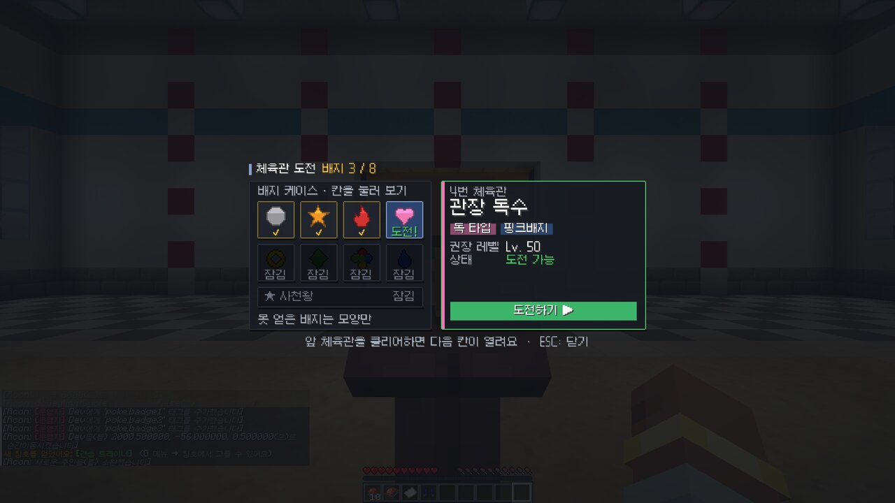
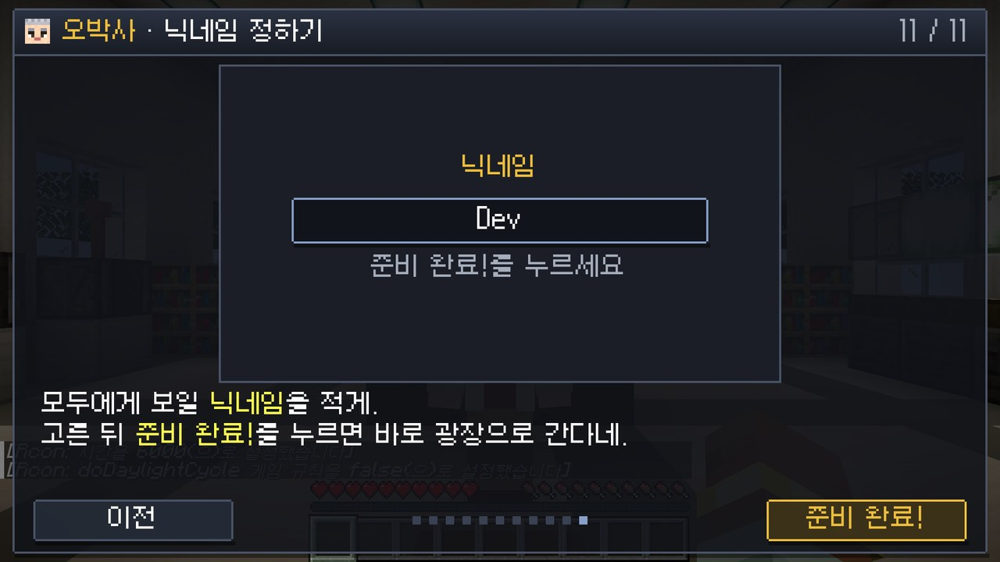
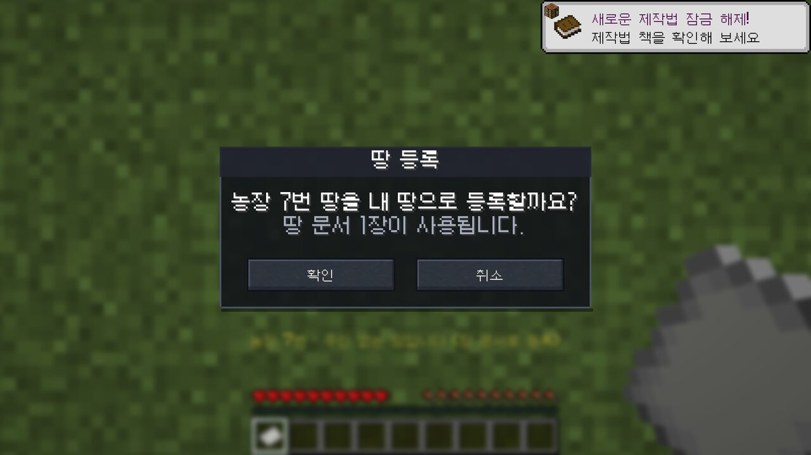
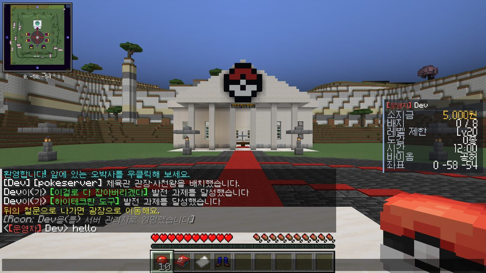
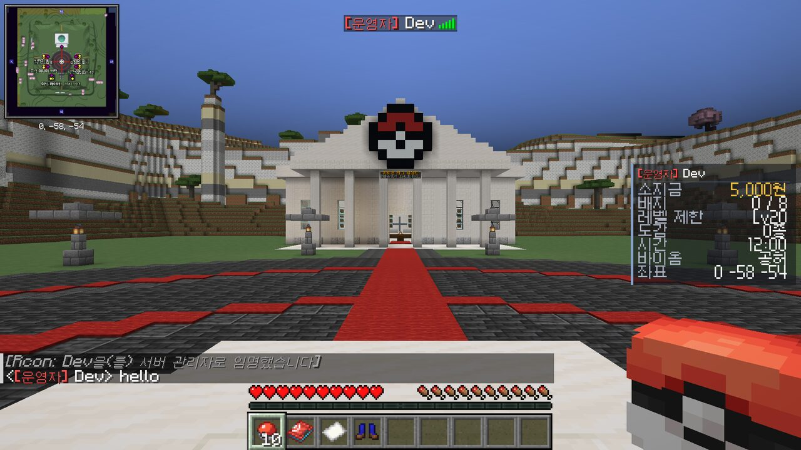
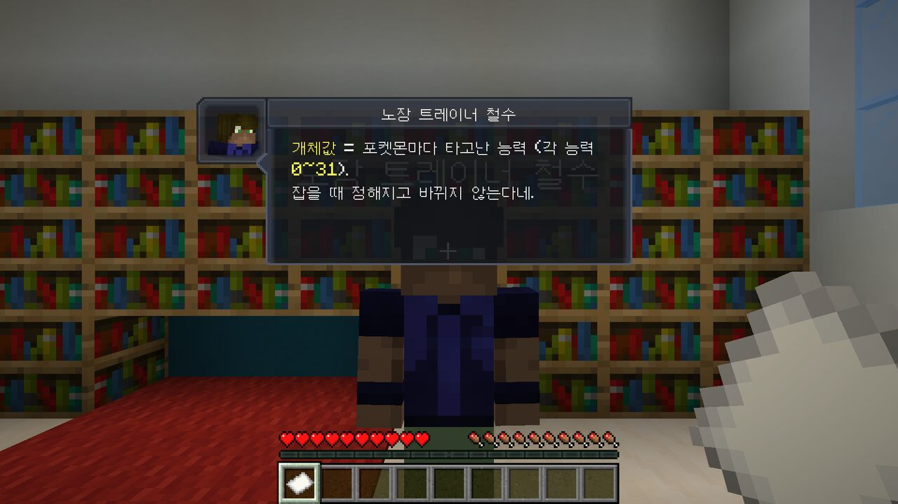

# UI 정리 (실제 화면)

- 모든 사진: 실제 클라이언트, **전체 화면 1920×1080, GUI 크기 자동**.
- 어두운 반투명 색, 갈무리 글꼴. 글이 길면 "…"로 자름.
- 줄바꿈: 단어 사이에서만. 문장 끝에서 끊어도 줄 길이가 비슷하면 **문장 끝 우선**.
- 큰 돈(9,876,543,210,987원)으로 찍어 **넘침 없음** 확인. 칸보다 길면 "123.4억"처럼 줄임.
- UI를 바꾸면 이 사진도 다시 찍는다 (`tools/shots.sh`, `docs/ui/`).

## 1. 메인 메뉴 (G 키)

- 참고 사진 구성. 왼쪽: "메인 메뉴" 제목, 분류 탭 **포켓몬 · 간편 메뉴 · 워프**(고른 탭 파란색), 맨 아래 작은 버튼 **명령어 · 휴지통**.
- 오른쪽 위: 고른 분류의 칸 (아이콘 + 이름).
  - 포켓몬: 내 파티 · PC · 도감 / 간편 메뉴: 튜토리얼 · 기본 명령어 · 휴지통 / 워프: 광장 · 야생 · 농장 · 체육관.
- 그 아래 **내 정보 카드**: 얼굴·[별명] 닉네임, 잡은 포켓몬·마주친 포켓몬(수 / 전체 종 · %, 막대) | 잔액 · 배지.
- 맨 아래 **공지사항** 줄 (길면 마우스를 올려 전체 보기).
- 튜토리얼 전엔 워프 칸이 흐리게 잠김. 마지막으로 고른 분류는 다시 열어도 유지.
- 코드: `MenuScreen.java`

### 오른쪽 정보창 (항상)

- 참고 사진처럼 두 묶음, 줄 간격 넓게(같은 간격): **위치 · 소지금 · 배지** / **시간 · 바이옴 · 좌표**. 맨 위 [별명] 닉네임.
- 위치: 광장 마을 / 야생 / 농장 / 체육관 / 오박사 연구소. 묶음마다 왼쪽 세로줄, "이름 ∥ 값".
- 화면(메뉴·배틀)이 열리면 숨김 (배틀 정보창과 겹치지 않게).
- 왼쪽 위 미니맵: Xaero's Minimap.
- 코드: `InfoHud.java`

### 명령어 버튼

- `/명령어` 목록을 채팅에 띄움 (한국어·영어). 전체 목록: [명령어.md](명령어.md)

### 휴지통 버튼

- 상자 화면 3줄. 넣고 닫으면 사라짐.

## 2. 상점 (점원 우클릭)

- 왼쪽 분류 9개, 위 구매/판매 탭·잔액·검색, 가운데 카드 가로 5칸.
- GUI가 작으면(전체 화면 자동 크기) 화면 전체를 줄여 그림 → 분류·안내 글이 안 잘림.

### 수량 창 (카드 클릭)

- −/+, 1·8·16·32·64, 휠·방향키 → "구매하기"(Enter).

### 판매 탭

- 카드마다 보유 수량 띠 (없으면 "보유 아이템 없음").
- 코드: `ShopScreen.java`

## 3. 체육관 도전 (안내원 우클릭)

- 도전 가능: 초록 테두리. 클리어: 하늘색 + CLEARED. 다른 사람 도전 중: 주황.
- 카드: 관장, 타입, 배지, 권장 레벨.
- 코드: `GymScreen.java`

### 배틀 (관장 우클릭)

- 참고 사진 분석: 납작한 어두운 반투명 판 + 얇은 테두리 + 둥근 모서리, 크기는 GUI 약 2.4배.
- **크기**: 전체 화면(GUI 자동 4배)에서도 배틀 화면만 **2.5배 크기**로 줄여 그림 (체력 판 약 350px 폭, 참고 340px). 마우스 위치도 맞춤.
- **체력 판**(왼쪽 위 내 포켓몬, 오른쪽 위 상대): 초상화 칸 + 이름·Lv + 체력 막대.
- **행동 버튼**(싸운다 · 포켓몬 · 포기): 왼쪽 색 아이콘 칸(빨강·초록·흰색) + 이름.
- **기술 버튼** 2×2: 왼쪽 타입 색 아이콘 칸 + 기술 이름, 아래 줄 분류·PP. 마우스를 올리면 테두리가 타입 색.
- 배틀 기록(오른쪽 아래)·뒤로 버튼도 같은 디자인. Extended Battle UI: 기술 상성·속도 범위·BATTLE INFO.
- 코드: 텍스처 `tools/battle_skin.py` → 내장 리소스팩, 크기·글자 위치 `BattleScale.java`·`client/mixin/`

## 4. 오박사 튜토리얼

- 11쪽: 잡기 · 배틀 · 상태창 · **도감(스캔 사진)** · 메뉴 · 상점 · 센터 · 체육관 · 규칙 · 스타팅 · **닉네임**.
- 창을 크게: 화면 크기에 맞춰 키움. 줄 간격 넓게 (최대 3줄).
- 머리 줄: 오박사 · 쪽 제목, 쪽 번호. 아래: 이전 · 쪽 점 · 다음/준비 완료!
- 코드: `TutorialScreen.java`, 사진 `textures/gui/tutorial/`

### 마지막 쪽: 닉네임 정하기

- 키보드로 입력 (한글·영어·숫자·_ 2~12글자). 틀리면 빨간 테두리·안내.
- 준비 완료! → 보상·스타팅 포켓몬 → **뒤의 철문**으로 나가면 광장 마을.

## 5. 땅 등록 팝업

- 땅 문서로 빈 땅 우클릭 → 확인/취소.
- 코드: `ClaimScreen.java`

## 6. 텔레포트 요청 (채팅)

- `/가기 닉네임`(`/tpa`) · `/부르기 닉네임`(`/tpahere`). 받는 사람: `[예] [아니요] (10초)` — 눌러서 대답 (`/수락` `/거절`).
- 보낸 사람: "요청을 보냈어요" 안내. 10초 지나면 둘 다에게 취소 안내.
- 코드: `Teleport.java`

## 7. 닉네임·별명 (채팅·탭 목록·머리 위)

- `[별명] 닉네임`: 운영자(빨강) > 챔피언(금) > 배지 마스터(보라) > 베테랑 트레이너(하늘) > 견습 트레이너(초록).
- 코드: `Nicknames.java`, 믹스인 `PlayerNameMixin`·`TabNameMixin`

## 8. Cobblemon 기본 화면 (모드 그대로)

- 스타팅 포켓몬 선택: 한 세대 3마리만.
- 팁 NPC 대화: 중요한 말 노란색.
- 그 밖에 파티 HUD, 상태창(M), PC, 도감, 배틀 화면.
