# UI 정리 (실제 화면)

- 모든 사진: 실제 클라이언트, **전체 화면 1920×1080, GUI 크기 자동**.
- 어두운 반투명 색, 갈무리 글꼴. 글이 길면 "…"로 자름.
- 줄바꿈: 단어 사이에서만. 문장 끝에서 끊어도 줄 길이가 비슷하면 **문장 끝 우선**.
- 큰 돈(9,876,543,210,987원)으로 찍어 **넘침 없음** 확인. 칸보다 길면 "123.4억"처럼 줄임.
- UI를 바꾸면 이 사진도 다시 찍는다 (`tools/shots.sh`, `docs/ui/`).

## 1. 메인 메뉴 (G 키)
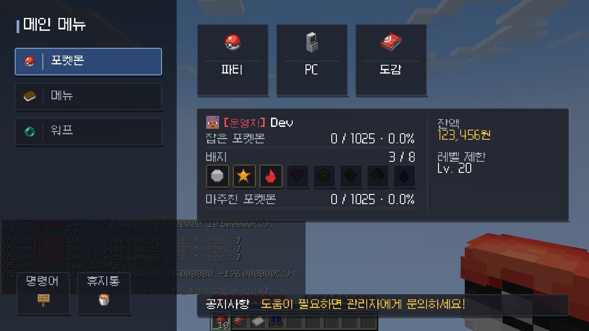
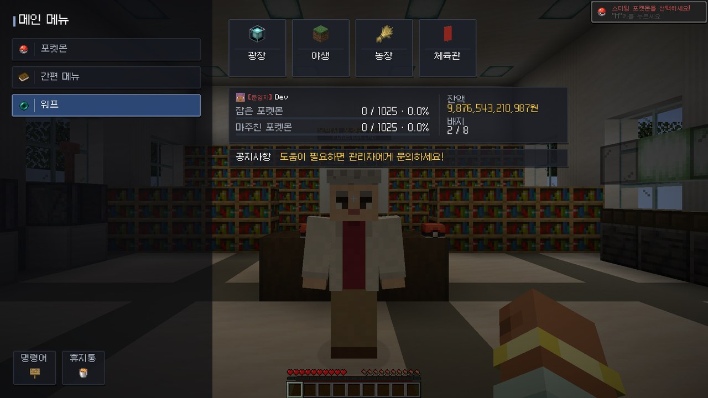
- 참고 사진 구성. 왼쪽: "메인 메뉴" 제목, 분류 탭 **포켓몬 · 간편 메뉴 · 워프**(고른 탭 파란색), 맨 아래 작은 버튼 **명령어 · 휴지통**.
- 오른쪽 위: 고른 분류의 칸 (아이콘 + 이름).
  - 포켓몬: 내 파티 · PC · 도감 / 간편 메뉴: 튜토리얼 · **칭호** · 기본 명령어 · 휴지통 / 워프: **광장**(광장 마을, 항상 같은 자리) · **야생**(광장 밖 야생에서 마지막으로 있던 자리, 처음이면 광장 북쪽 출구 밖) · 농장(마지막 위치) · 체육관.
- **G 키를 한 번 더 누르면 닫힘** (ESC와 같음).
- 그 아래 **내 정보 카드**: 얼굴·[칭호] 닉네임(큰 글씨), 잡은 포켓몬(막대) → **배지 케이스 8칸** → 마주친 포켓몬(막대) | 잔액 · **레벨 제한**.
  - 배지 케이스: 얻은 배지는 배지 그림이 그대로, 못 얻은 배지는 어두운 모양(실루엣)만.
- **공지사항**은 창 맨 아래 줄 (길면 마우스를 올려 전체 보기).
- 튜토리얼 전엔 워프 칸이 흐리게 잠김. 마지막으로 고른 분류는 다시 열어도 유지.
- **튜토리얼** 칸: 오박사에게 이동하지 않고 설명 창만 다시 열림. 마지막 쪽 "준비 완료!"는 창만 닫음.
- 코드: `MenuScreen.java`

### 오른쪽 정보창 (항상)
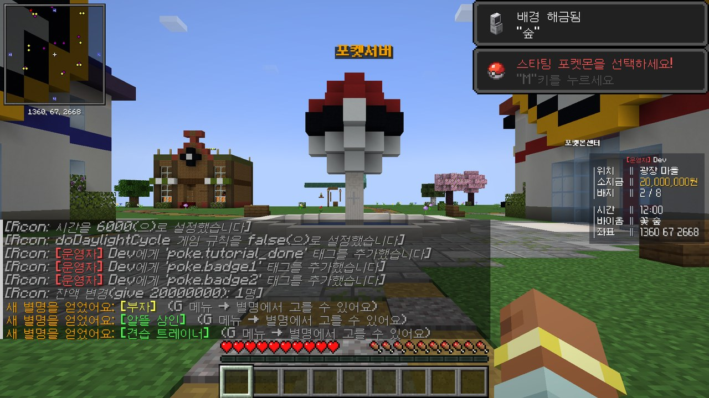
- 참고 사진 크기(전체 화면에서 GUI 2배 크기)로 작게. 두 묶음, 줄 간격 넓게(같은 간격): **위치 · 소지금 · 배지** / **시간 · 바이옴 · 좌표**. 맨 위 [칭호] 닉네임(큰 글씨).
- 시간 = **접속 후 플레이 시간**(시:분, 다시 접속하면 0부터). 창 폭은 가장 넓었던 폭을 유지해서 숫자가 바뀌어도 흔들리지 않음.
- 위치: 광장 마을 / 포켓몬 센터 / 상점 / 야생 / 농장 / 체육관(로비) / 경기장 / 사천왕 본부 / 오박사 연구소. 공간 BGM도 이 값으로 고름 (BGM 문서). 묶음마다 왼쪽 세로줄, "이름 ∥ 값".
- 오른쪽 위 알림(토스트, 예: 레시피 해금)은 안 뜸 (`ToastMixin`).
- 화면(메뉴·배틀)이 열려 있거나 **배틀 중**(배틀 화면을 닫아 둔 동안도)이면 숨김.
- **오른쪽 아래 미니맵**: Xaero's Minimap (왼쪽 위에 있으면 Cobblemon 파티 표시를 가려서 옮김, `pack/config/xaerohud.txt`). **배틀 중엔 숨김** (`MinimapMixin`).
- 코드: `InfoHud.java`

### 명령어 버튼

- `/명령어` 목록을 채팅에 띄움 (한국어·영어). 전체 목록: [명령어.md](명령어.md)

### 휴지통 버튼

- 상자 화면 3줄. 넣고 닫으면 사라짐.

## 2. 상점 (점원 우클릭)

- 왼쪽 분류: 포켓몬 상점 7개(볼·회복·성장·도구·능력치·기믹·기타), 생활 상점 4개(농장·블록·잡화·건축). **기타**는 판매 전용 (코블몬에서 얻는 물품 중 상점에서 안 파는 것), 위 구매/판매 탭·잔액·검색, 가운데 카드 가로 5칸.
- GUI가 작으면(전체 화면 자동 크기) 화면 전체를 줄여 그림 → 분류·안내 글이 안 잘림.

### 수량 창 (카드 클릭)

- −/+, 1·8·16·32·64, 휠·방향키 → "구매하기"(Enter).

### 판매 탭
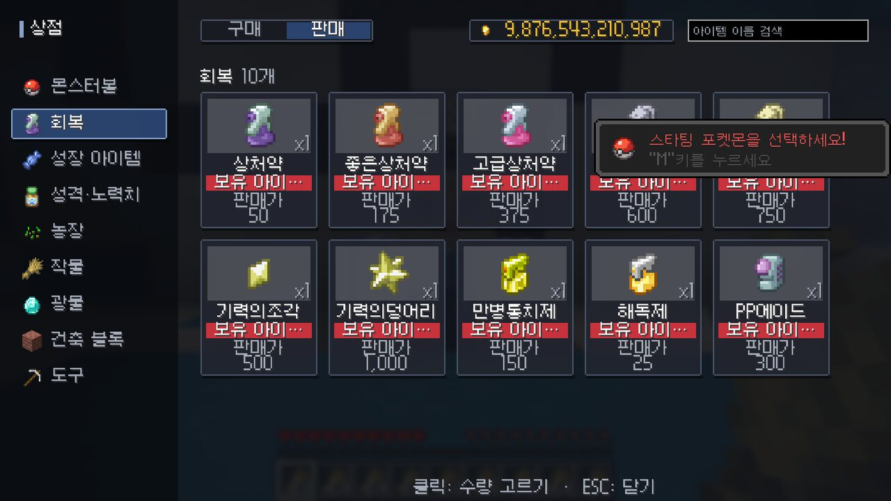
- 카드마다 보유 수량 띠 (없으면 "보유 아이템 없음").
- 팔기는 배지 제한 없음 (서버 `Shop.trade`는 판매가만 확인, 배지는 구매 탭에서만 거름).
- 코드: `ShopScreen.java`

## 3. 체육관 도전 (안내원 우클릭)

- **체육관 리그 로드맵** (참고 사진 풍, 다른 창과 같은 어두운 판·하늘색 강조). 맨 밑 안내 글은 없음 (ESC로 닫기).
- 위: 제목 탭 "체육관 리그 로드맵" + 오른쪽 금색 **배지 n / 8**.
- 가운데: 1~8번 체육관 칸이 **지그재그 길**로 이어지고 끝에 **사천왕**.
  - 깬 곳: 초록 테두리 + 배지 그림 + ✔, 아래 관장 이름. 길도 초록.
  - 지금 도전할 곳: **하늘색으로 빛남 + 내 얼굴**, 아래 "도전 가능". 다른 사람이 도전 중이면 주황 "도전 중".
  - 잠긴 곳: 어두운 배지 모양 + 자물쇠, 길은 점선.
  - **사천왕**: 보라 큰 칸에 **?** 하나 (8개를 모으면 보라로 빛남). 정보는 일부러 안 보여 줌.
- 아래 정보창 (칸을 누르면 바뀜): 왼쪽 몇 번 체육관·타입, 관장, 권장 레벨, 상태 / 오른쪽 **보상**(배지 그림, 상금, 2·4·6·8번은 기믹 도구, 경험사탕 10·기술머신) + **체육관 이동 ▶** 버튼.
  - 깬 곳은 버튼 대신 CLEARED 도장, 잠긴 곳은 "잠김", 도전 중이면 주황 "도전 중"(누르면 흔들림 + 가운데 알림).
  - **사천왕은 제목만** 있고 관장·레벨·보상은 모두 **?** (미스터리).
- 보상 정보는 `tools/build_league.py`가 `league.json`에 함께 씀 (상금 = 레벨 제한 × 200, 실제 지급과 같은 식).
- 코드: `GymScreen.java`

### 배틀 (관장 우클릭)

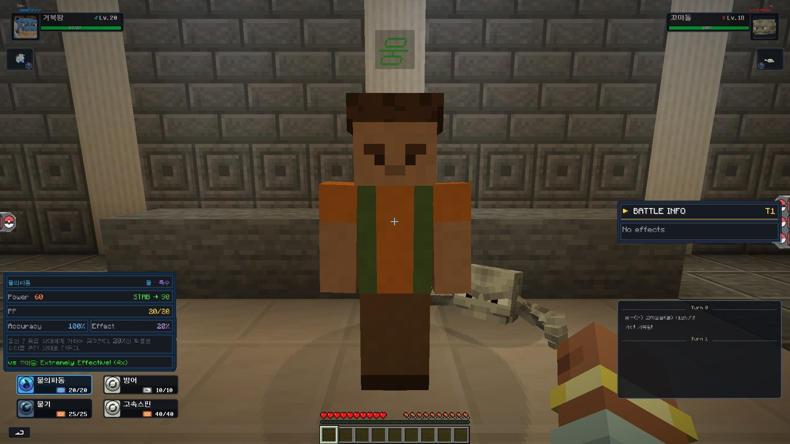
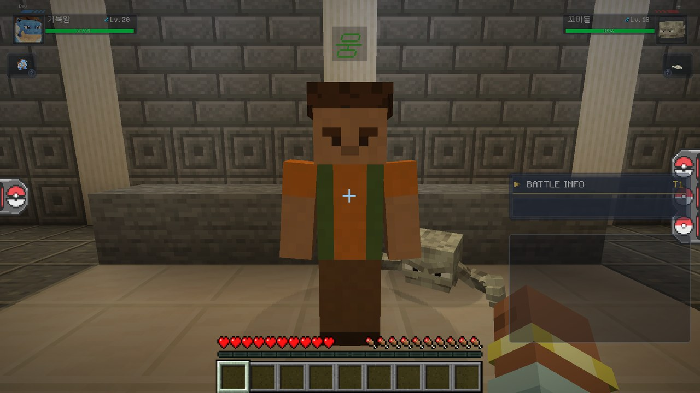
- 참고 사진 분석: 납작한 어두운 반투명 판 + 얇은 테두리 + 둥근 모서리, 크기는 GUI 약 2.4배.
- **크기**: 전체 화면(GUI 자동 4배)에서도 배틀 화면만 **2.5배 크기**로 줄여 그림 (체력 판 약 350px 폭, 참고 340px). 마우스 위치도 맞춤.
- **체력 판**(왼쪽 위 내 포켓몬, 오른쪽 위 상대): 초상화 칸 + 이름·Lv + 체력 막대.
- **행동 버튼** (참고 사진 배치): 싸운다 | 포켓몬 / 포기(도망) 아래 왼쪽, 야생이면 잡기 아래 오른쪽. 크기는 코블몬 기본(1080p에서 약 225×65px), 이름 글자만 정수 픽셀 배율(1.2)로 또렷하게 (`OptionTileMixin`). 기술 버튼의 기술 이름도 같은 방식 (`MoveTileMixin`, PP 숫자는 커지면 아이콘에 붙어서 그대로). HUD와 겹치지 않으면 위로 올리지 않음 (`BattleScale.lift`).
- **전투 속도** 버튼 (행동 버튼 위, `GeneralActionMixin`): 1x·2x·4x. 서버가 배틀 기다림(`dispatchWaiting`)과 기술 연출 기다림(`delayedFuture`)을 나눔 (`BattleSpeedMixin`·`ActionSpeedMixin`·`DelaySpeedMixin`). 실측: 1x 한 턴 5.7~7.4초 → 4x 2.1초.
- **배틀 정보 판**(EBUI) 오른쪽 끝을 24 줄여 오른쪽 상대 파티 볼 줄을 안 가림 (왼쪽 끝은 그대로, `EbuiConfigMixin`).
- 배틀 화면이 열려 있으면 **채팅을 행동 버튼 위로** 올려 그림 (관장 대사가 안 가려지게, `BattleChatMixin`).
- Extended Battle UI 한국어: 언어 파일 + 코드에 박힌 글자(배틀 정보·N턴·체력 변화 줄·기술 설명의 위력·명중·자속 등, `EbuiTextMixin`·`EbuiTooltipMixin`).
- **기술 버튼** 2×2: 왼쪽 타입 색 아이콘 칸 + 기술 이름, 아래 줄 분류·PP. 마우스를 올리면 테두리가 타입 색.
- 배틀 기록(오른쪽 아래)·뒤로 버튼도 같은 디자인. Extended Battle UI(BATTLE INFO 판·배틀 기록)도 같은 2.5배 크기로 줄여 서로 안 겹침.
- 배틀 화면을 닫아 두면(ESC) 체력 판·BATTLE INFO만 보이고 미니맵·오른쪽 정보창은 숨김.
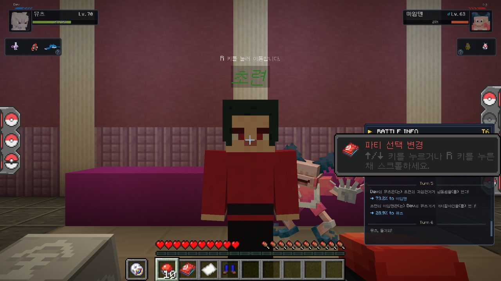
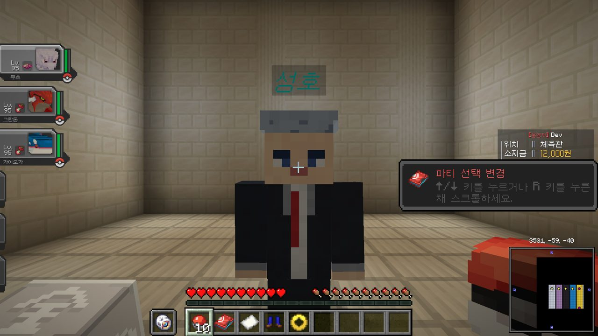
- 배틀 기록(EBUI)은 배틀 화면과 같은 비율로 줄여 그리고, 잘라 그리는 칸도 같은 비율로 (`EbuiScissorMixin`; 예전엔 글자 앞부분이 잘리거나 안 보였음).
- 관장·사천왕 말풍선·대사는 한국어 (RCT 대사 파일 + 모드 언어 파일).
- **특수 기믹 버튼** (기술 고르기 칸 아래, 뒤로 버튼 옆): 진행도가 모자라면 아예 안 나옴 (메가 배지 4개, 다이맥스 6개, 테라스탈 8개부터, Z는 제한 없음). 아래 사진은 예전 기준(Z 배지 6개, 다이맥스·테라 사천왕 클리어)에 찍은 것이지만 버튼 모양은 같음.
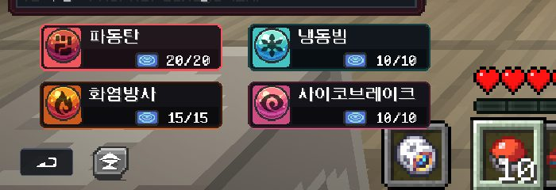
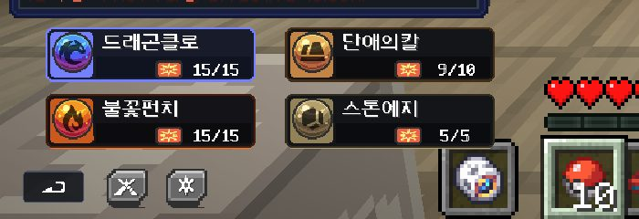
- 코드: 텍스처 `tools/battle_skin.py` → 내장 리소스팩, 크기·글자 위치 `BattleScale.java`·`client/mixin/`

## 4. 오박사 튜토리얼

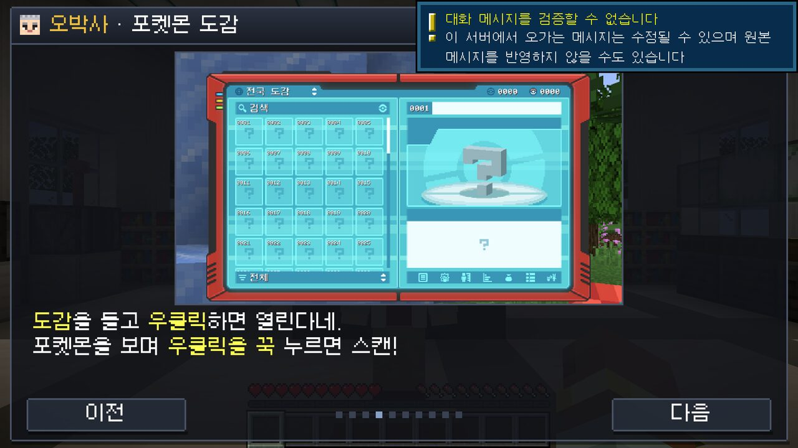
- 11쪽: 잡기 · 배틀 · 상태창 · **도감(스캔 사진)** · 메뉴 · 상점 · 센터 · 체육관 · 규칙 · 스타팅 · **닉네임**.
- 창을 크게: 화면 크기에 맞춰 키움. 줄 간격 넓게 (최대 3줄).
- 머리 줄: 오박사 · 쪽 제목, 쪽 번호. 아래: 이전 · 쪽 점 · 다음/준비 완료!
- 코드: `TutorialScreen.java`, 사진 `textures/gui/tutorial/`

### 마지막 쪽: 닉네임 정하기

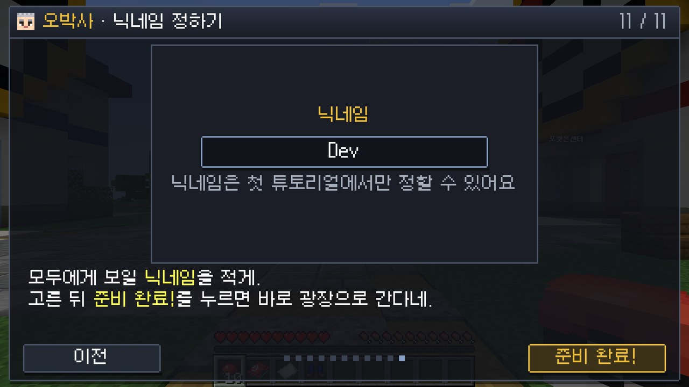
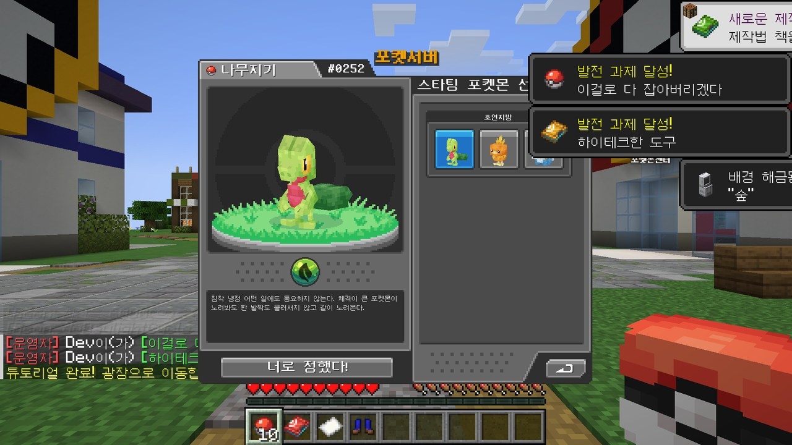
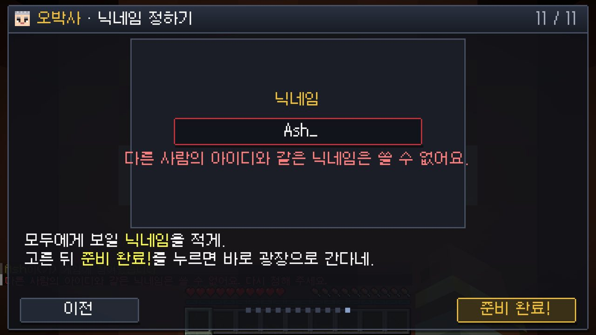
- 키보드로 입력 (한글·영어·숫자·_ 2~12글자). 틀리면 빨간 테두리·안내.
- 다른 사람의 닉네임·아이디와 겹치면 닉네임 쪽이 다시 열리고 빨간 글씨로 "다른 사람의 아이디와 같은 닉네임은 쓸 수 없어요."
- 준비 완료! → 보상 → **바로 광장 마을로 이동** → 2초 뒤 스타팅 포켓몬 고르기 창.
- 닉네임은 **첫 튜토리얼에서만** 정함. 다시 보면 이 쪽은 지금 닉네임만 보여 주고 바꿀 수 없음 ("닉네임은 이미 정했네. 다 읽었으면 준비 완료!를 누르게").

## 5. 땅 등록 팝업

- 땅 문서로 빈 땅 우클릭 → 확인/취소.
- 코드: `ClaimScreen.java`

## 6. 텔레포트 요청 (채팅)

- `/가기 닉네임`(`/tp`) · `/부르기 닉네임`(`/tpa`). 받는 사람: `[예] [아니요] (10초)` — 눌러서 대답 (`/수락` `/거절`).
- 보낸 사람: "요청을 보냈어요" 안내. 10초 지나면 둘 다에게 취소 안내.
- 코드: `Teleport.java`

## 7. 닉네임·칭호 (채팅·탭 목록·머리 위)

- `[칭호] 닉네임`. 칭호는 조건을 채우면 얻고 **G 메뉴 → 메뉴 → 칭호**에서 고름 (안 고르면 가장 높은 것, "표시 안 함"도 가능).
- 칭호 40개 (2.4.0): 리그·대결·도감·포획·야생·육성·배틀 기믹·돈·농장·꾸준함 갈래. 고르기 창은 5칸씩, **같은 갈래는 같은 줄에서 시작**. 우선순위·정확한 조건은 [칭호](칭호.md).
- 칭호 고르기 창의 말풍선은 **힌트만** (정확한 조건 수치는 안 보임). 전체 목록·정확한 조건·확장안은 [칭호](칭호.md).
- 새 칭호를 얻으면 본인에게 알림, ★ 칭호(챔피언·무적의 챔피언·퍼스트 클리어·포켓몬 마스터·영웅·럭키·빛나는부적)는 서버 전체 공지.

### 칭호 고르기
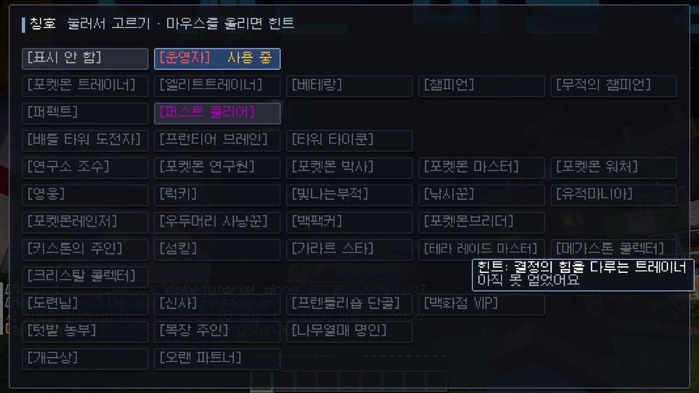
- 3칸씩, 칸에는 칭호만 (폭을 줄임). **가진 칭호**: 밝은 칸 + 칭호 색. **없는 칭호**: 어두운 칸 + 회색 글자(색 없음). 사용 중인 것은 파란 칸 + "사용 중".
- **얻는 조건은 칸에 마우스를 올리면 말풍선**으로 (얻었는지도 같이). 마우스를 떼면 사라짐.
- 코드: `Titles.java`(서버), `TitleScreen.java`
- 코드: `Nicknames.java`, 믹스인 `PlayerNameMixin`·`TabNameMixin`

### 전체 초기화 (`/초기화`)
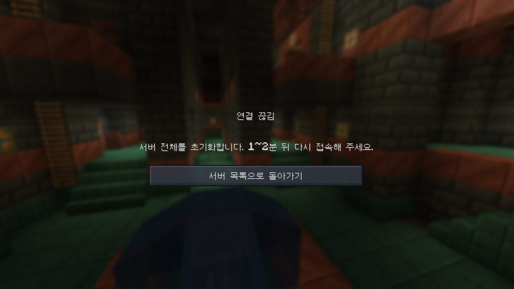
- 접속한 모두에게 "서버 전체를 초기화합니다. 1~2분 뒤 다시 접속해 주세요." → 서버가 꺼지고 새 월드로 다시 켜짐.

## 8. Cobblemon 기본 화면 (모드 그대로)

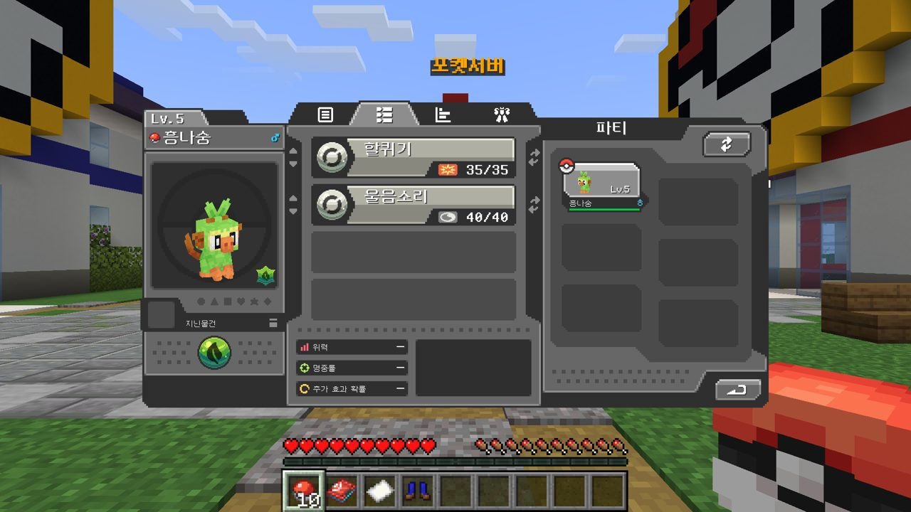

- 스타팅 포켓몬 선택: 한 세대 3마리만. **Lv.5**, 기술은 그 포켓몬이 처음 나온 원작 게임의 시작 기술 (예: 흥나숭 할퀴기·울음소리).
- 팁 NPC 대화: 중요한 말 노란색.
- 그 밖에 파티 HUD, 상태창(M), PC, 도감, 배틀 화면.

### 체력·배고픔·경험치 HUD (B안)
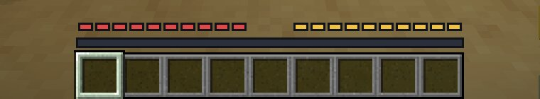
- 1080p에서 1 GUI 픽셀 = 3픽셀로 줄여 그림 (참고 사진 = GUI 크기 3, `HudScaleMixin`). 바 높이 4px.
- 하트·배고픔 → 칸 10개 바 (각 79px, 바닐라 81px 자리 그대로), 경험치 → 182px 파란 바 + 하늘색 레벨 숫자. 핫바·갑옷·공기·탈것 체력은 바닐라.
- 체력: 빨강, 20% 이하 밝은 빨강, 독 보라, 시듦 회보라, 얼음 하늘색, 피해 순간 흰 테두리, 흡수 체력은 바 위 금색 줄. 체력 최대가 20을 넘어도 한 줄(비율).
- 배고픔: 노랑, 허기 효과 초록, 오른쪽부터 참. 코드 `client/mixin/HudBarsMixin`.
