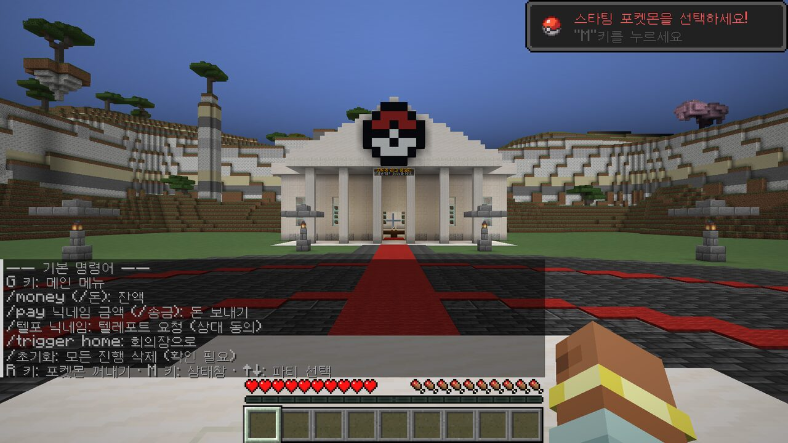
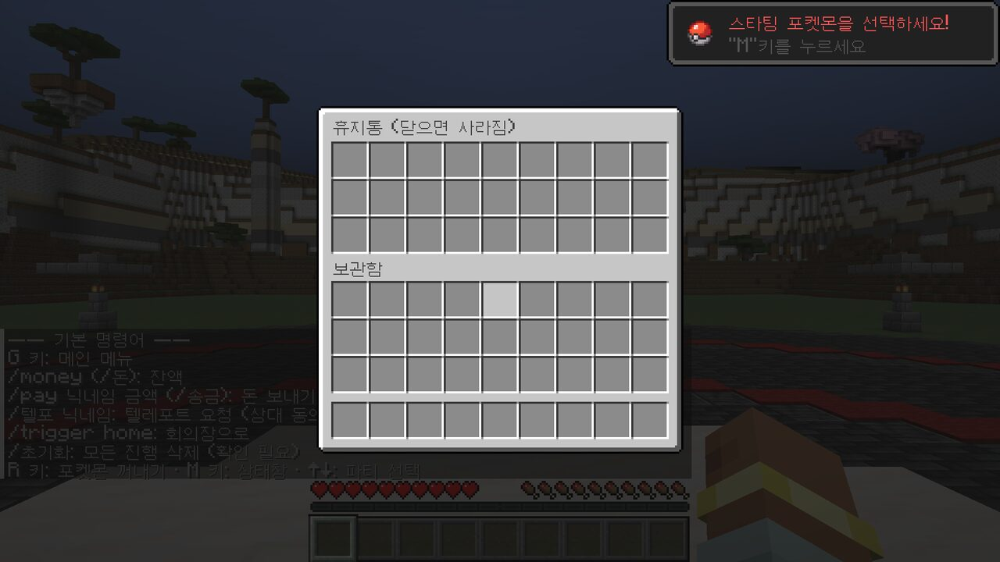
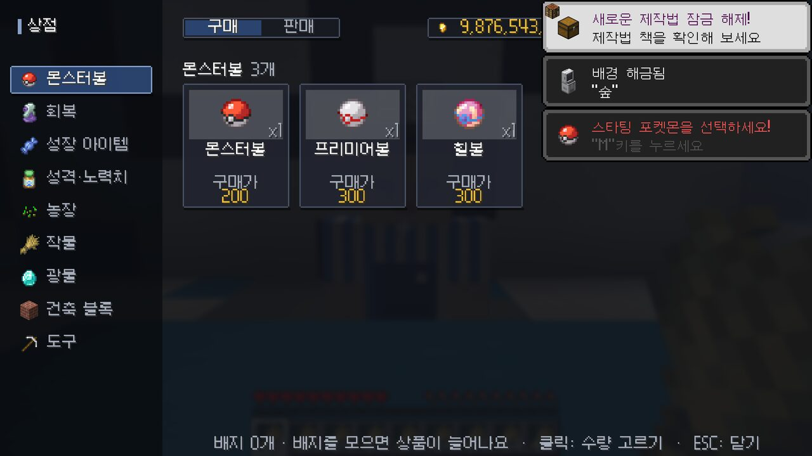
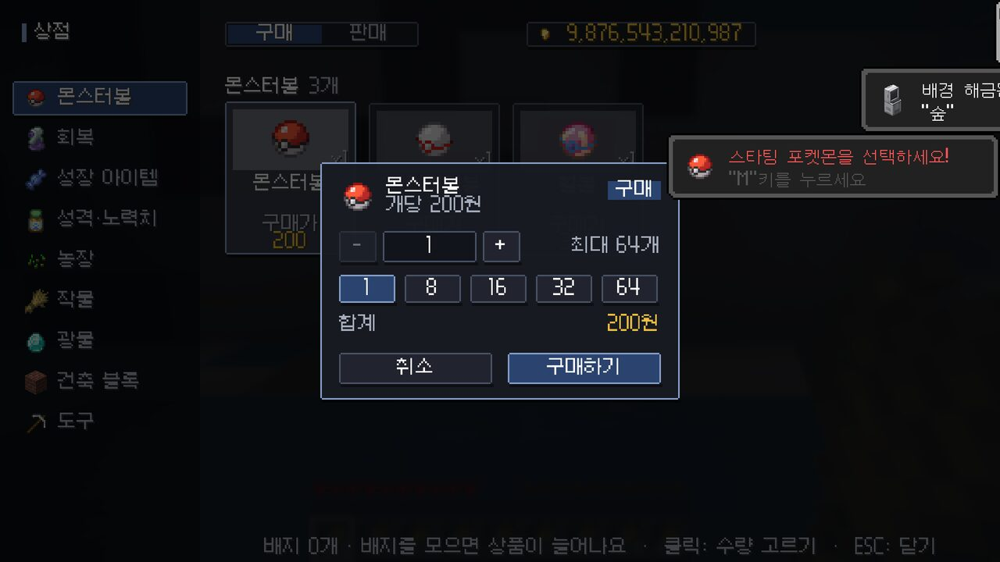
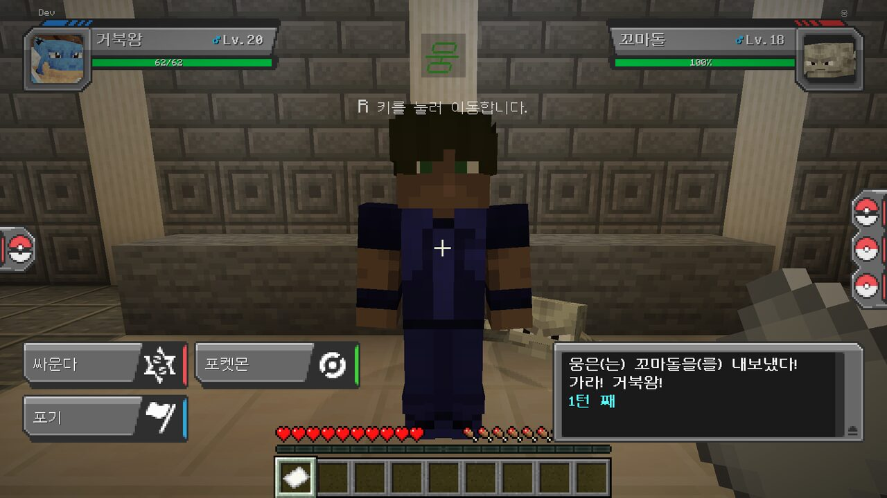
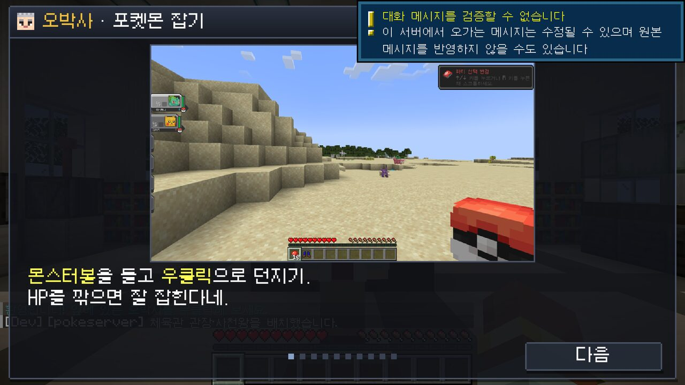
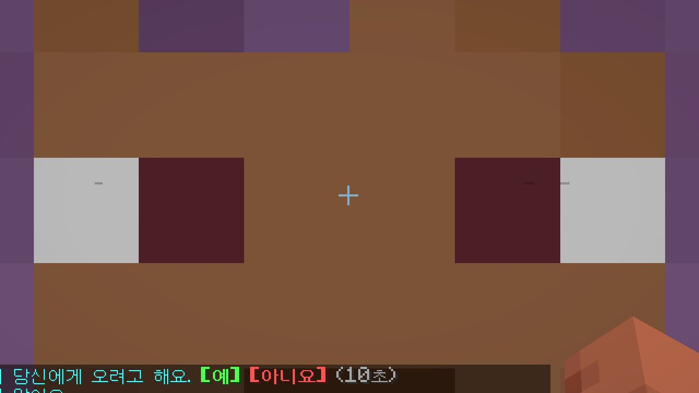
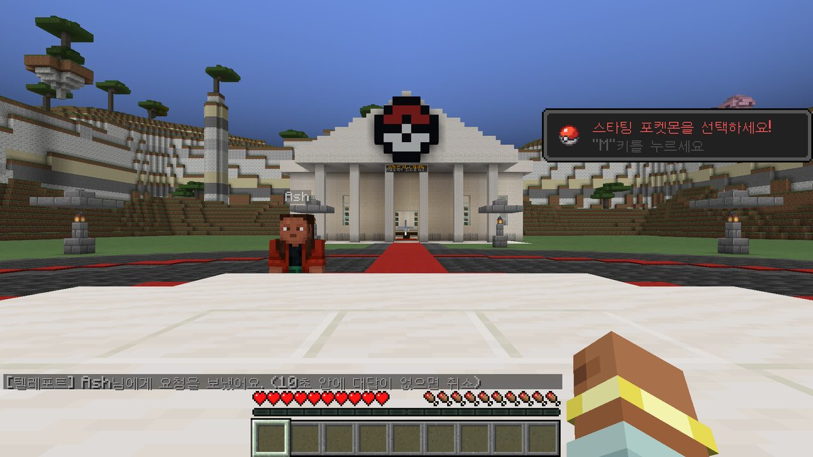
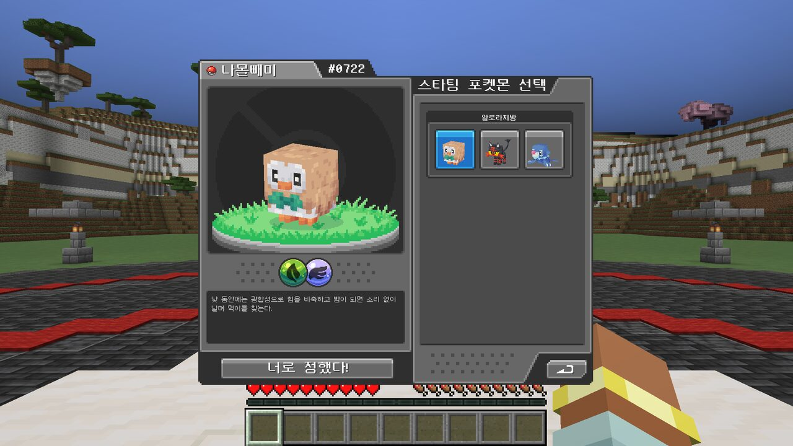

# UI 정리 (실제 화면)

- 모든 사진: 실제 클라이언트, **전체 화면 1920×1080, GUI 크기 자동**.
- 어두운 반투명 색, 갈무리 글꼴. 글이 길면 "…"로 자름.
- 줄바꿈: 단어 사이에서만. 문장 끝에서 끊어도 줄 길이가 비슷하면 **문장 끝 우선**.
- 큰 돈(9,876,543,210,987원)으로 찍어 **넘침 없음** 확인. 칸보다 길면 "123.4억"처럼 줄임.
- UI를 바꾸면 이 사진도 다시 찍는다 (`tools/shots.sh`, `docs/ui/`).

## 1. 메인 메뉴 (G 키)

- 제목 줄: 포켓몬 레벨 제한 · 메인 메뉴 · 잔액.
- 큰 칸 4×2: 내 파티 · PC · 도감 · 체육관 / 광장 · 상점가 · 야생 · 농장.
- 튜토리얼 전엔 워프 칸이 흐리게 잠김.
- 아래: 공지 줄, 작은 버튼(튜토리얼 · 휴지통 · 명령어 / 닫기).
- 코드: `MenuScreen.java`

### 명령어 버튼

- 기본 명령어를 채팅에 띄움. 전체 목록: [명령어.md](명령어.md)

### 휴지통 버튼

- 상자 화면 3줄. 넣고 닫으면 사라짐.

## 2. 상점 (점원 우클릭)

- 왼쪽 분류 9개, 위 구매/판매 탭·잔액·검색, 가운데 카드 가로 5칸.
- GUI가 작으면(전체 화면 자동 크기) 화면 전체를 줄여 그림 → 분류·안내 글이 안 잘림.

### 수량 창 (카드 클릭)

- −/+, 1·8·16·32·64, 휠·방향키 → "구매하기"(Enter).

### 판매 탭

- 카드마다 보유 수량 띠 (없으면 "보유 아이템 없음").
- 코드: `ShopScreen.java`

## 3. 체육관 도전 (안내원 우클릭)

- 도전 가능: 초록 테두리. 클리어: 하늘색 + CLEARED. 다른 사람 도전 중: 주황.
- 카드: 관장, 타입, 배지, 권장 레벨.
- 코드: `GymScreen.java`

### 배틀 (관장 우클릭)

- Cobblemon 배틀 화면 그대로.

## 4. 오박사 튜토리얼

- 10쪽: 잡기 · 배틀 · 상태창 · **도감** · 메뉴 · 상점 · 센터 · 체육관 · 규칙 · 스타팅.
- 창을 크게: 화면 크기에 맞춰 키움. 줄 간격 넓게 (최대 3줄).
- 머리 줄: 오박사 · 쪽 제목, 쪽 번호. 아래: 이전 · 쪽 점 · 다음/준비 완료!
- 코드: `TutorialScreen.java`, 사진 `textures/gui/tutorial/`

## 5. 땅 등록 팝업

- 땅 문서로 빈 땅 우클릭 → 확인/취소.
- 코드: `ClaimScreen.java`

## 6. 텔레포트 요청 (채팅)

- 받는 사람: `[예] [아니요] (10초)` — 눌러서 대답.
- 보낸 사람: "요청을 보냈어요" 안내. 10초 지나면 둘 다에게 취소 안내.
- 코드: `Teleport.java`

## 7. Cobblemon 기본 화면 (모드 그대로)

- 스타팅 포켓몬 선택: 한 세대 3마리만.
- 팁 NPC 대화: 중요한 말 노란색.
- 그 밖에 파티 HUD, 상태창(M), PC, 도감, 배틀 화면.
